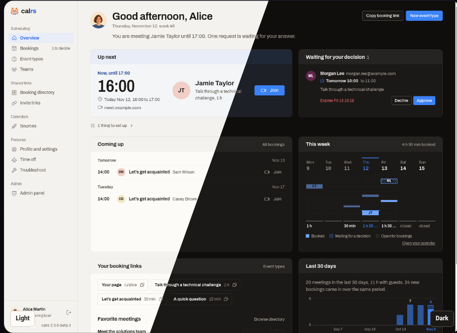
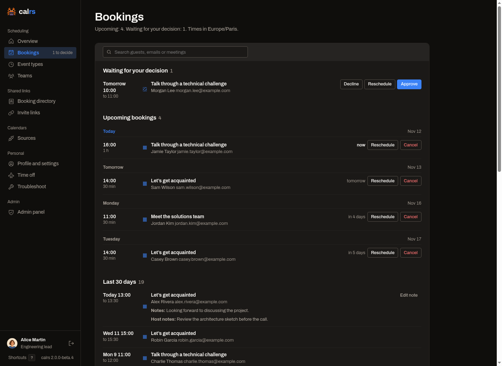
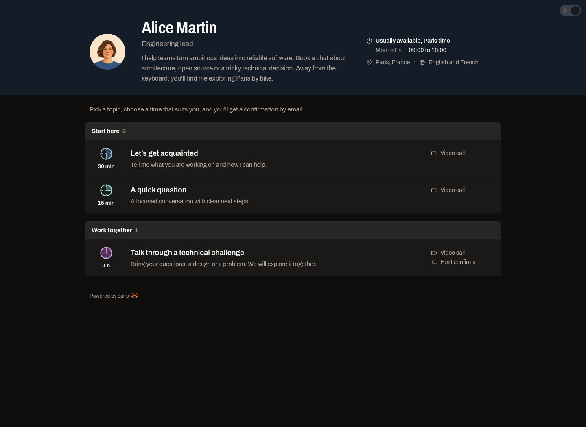
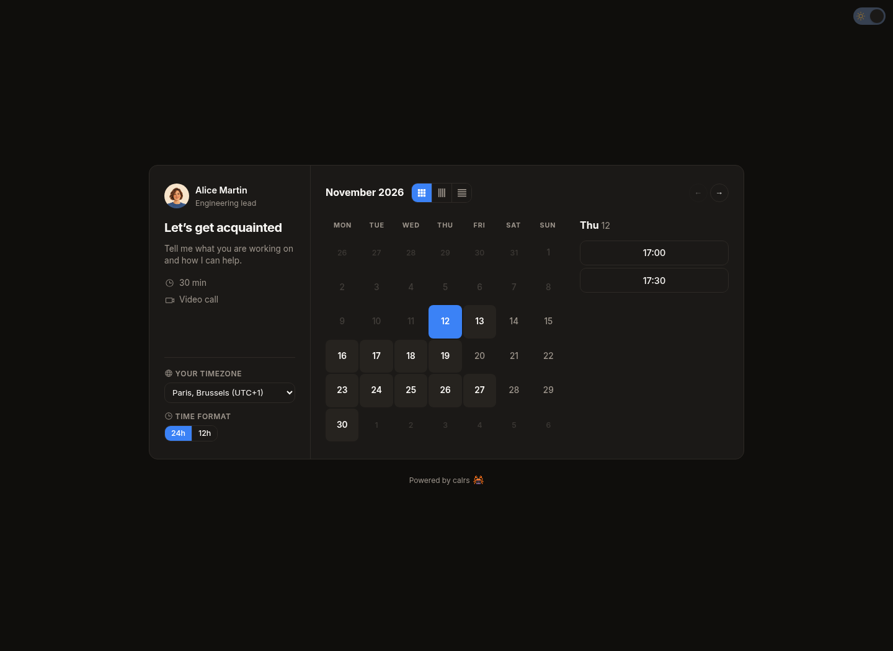
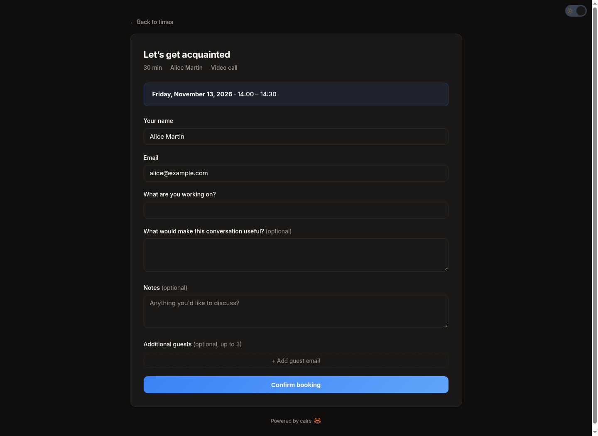

<p align="center">
  
</p>

# calrs

[](https://github.com/olivierlambert/calrs/actions/workflows/ci.yml)
[](https://codecov.io/gh/olivierlambert/calrs)

**Self-hosted scheduling, built in Rust. Your time, your stack.**

Connect CalDAV, Google Calendar, Microsoft 365 / Outlook or on-premises Exchange. Define your meeting types, share a link, and let guests book against your actual availability. Run calrs on your infrastructure with SQLite, one Rust executable and its templates, with no Node.js or separate database server.

<p align="center">
  <a href="https://cal.rs">Website</a> &middot;
  <a href="https://cal.rs/docs/">Documentation</a> &middot;
  <a href="https://github.com/olivierlambert/calrs/releases">Releases</a> &middot;
  <a href="docs/src/features.md">v2 feature guide</a>
</p>

> This branch documents **v2, currently in prerelease**. `latest` follows stable container releases; `next` follows betas and release candidates. Check [Releases](https://github.com/olivierlambert/calrs/releases) for available versions and read the [upgrade guide](docs/src/upgrading.md) before reusing an existing installation.

<p align="center">
  
</p>

## Features

### Calendars that work together

- **CalDAV** with discovery, incremental sync and write-back: Nextcloud, BlueMind, Fastmail, iCloud, SOGo, Zimbra, Radicale, Baikal and other compatible servers.
- **Google Calendar through OAuth2**, including out-of-office blocking and host-owned Google Meet links.
- **Microsoft 365 and Outlook.com through Microsoft Graph**, with delegated OAuth2 consent.
- **On-premises Exchange through EWS**, per mailbox or centrally provisioned with a service account and impersonation.
- **Separate read and write choices**: select calendars to sync, conflict calendars per event type, and each host's booking destination per event type.
- Background and on-demand sync, recurring-event handling, visible failures and calendar write-back retries.

Setup: [CalDAV](docs/src/caldav.md) · [Google](docs/src/google-calendar.md) · [Microsoft](docs/src/microsoft-calendar.md) · [Exchange](docs/src/exchange.md)

### Scheduling for people and teams

- Personal meetings, **round-robin** assignment by priority and workload, **collective** meetings with all eligible members, and dynamic groups such as `/u/alice+bob/intro`.
- Timezone-aware weekly hours, multiple daily windows, date overrides and **time off across every meeting you host**.
- Duration, slot interval, buffers, minimum notice, rolling booking horizons and fixed bookable date ranges.
- Daily/weekly/monthly/yearly frequency limits, including per-member team limits, and an earliest-slot-only display option.
- Optional host approval, pending slot holds, request expiry and approval reminders.
- Shared rooms and resources, watcher teams that can claim bookings, and an availability troubleshooter.

Guides: [Event types](docs/src/event-types.md) · [Teams](docs/src/teams.md) · [Resources](docs/src/resources.md)

### A complete booking flow

- Public profiles and team pages with meeting sections, ordering, profile facts and usual-hours summaries.
- Month, week and column slot views; guest timezone detection, 12/24-hour clocks and configurable first weekday.
- Public, internal and private meetings; guest-specific and bulk invitations, single-use links, expiry and usage limits.
- A searchable **booking directory**, favorites and shareable links on the dashboard.
- **Custom booking questions**, required fields and consent checkboxes, with a snapshot of the question and answer.
- Additional attendees, guest notes, separate **host-only notes**, cancellation, rescheduling and requests to pick a new time.
- Inline, floating-button and click-triggered **website embeds**.

Guides: [Booking flow](docs/src/booking-flow.md) · [Questions](docs/src/booking-questions.md) · [Dashboard](docs/src/dashboard.md) · [Embeds](docs/src/embedding.md)

### Notifications and meeting links

- Translated HTML/plain-text email, reminders and `.ics` invitations; confirmed bookings also offer an **Add to calendar** download without SMTP.
- Guest emails show the host's name and Reply-To address, with an optional instance or event-type footer.
- Opt-in **SMS** through Twilio, GatewayAPI, seven.io or a webhook gateway, with a daily limit measured in billed segments.
- Static video links, generated **Jitsi** rooms, **Google Meet**, meeting-provider webhooks, phone and in-person locations.

Guides: [Email](docs/src/booking-flow.md#email-notifications) · [SMS](docs/src/sms.md) · [Locations](docs/src/event-types.md#location)

### Integrations and administration

- **REST API** with scoped personal access tokens or OAuth, booking operations, optional question answers and OpenAPI 3.1. Signed-in interactive reference at `/api/docs`.
- **MCP over Streamable HTTP** at `/mcp`, with OAuth consent: list event types, generate invitations and read cached busy intervals.
- **Signed outgoing booking webhooks** with retries and stable delivery IDs.
- Local accounts with optional or required **TOTP MFA**, recovery codes, or **OIDC SSO** and group sync.
- Admin controls for registration, users, integration permissions, calendar health, SMTP, branding and impersonation.
- Ten languages plus formal German, light/dark modes, preset/custom themes, separate light/dark company logos and a favicon.
- Operator CLI, SQLite, credential encryption, CSRF protection, rate limiting and configurable trusted proxies.

Guides: [API](docs/src/api.md) · [MCP](docs/src/mcp.md) · [Webhooks](docs/src/webhooks.md) · [Authentication](docs/src/authentication.md) · [Admin](docs/src/admin.md) · [Security](docs/src/security.md)

The [v2 feature guide](docs/src/features.md) links the complete capabilities and their limits. Calendar OAuth and sign-in SSO are separate. MCP does not create bookings; the REST API supports booking operations.

## Screenshots

<table>
  <tr>
    <td><br>Bookings</td>
    <td><br>Public profile</td>
  </tr>
  <tr>
    <td><br>Choose a time</td>
    <td><br>Booking questions</td>
  </tr>
</table>

## Install

For a local v2 preview using its own data volume:

```bash
docker run -d --name calrs-v2 \
  -p 127.0.0.1:3000:3000 \
  -v calrs-v2-data:/var/lib/calrs \
  -e CALRS_BASE_URL=http://localhost:3000 \
  ghcr.io/olivierlambert/calrs:next
```

Open `http://localhost:3000` and register; the first user becomes admin. Configure your timezone and hours, connect a calendar, then create an event type. Podman accepts the same command with `podman` in place of `docker`. Images are built for `amd64` and `arm64`.

For production, select an exact available release tag, configure HTTPS through your reverse proxy and set `CALRS_BASE_URL` to the public origin. Back up **the database, credential key and uploaded files together**. The [deployment guide](docs/src/deployment.md) covers Compose, binary/systemd installs, SMTP, proxy trust, logs and backups; the [upgrade guide](docs/src/upgrading.md) explains v2 migrations and rollback.

### From source

```bash
cargo build --release --locked
./target/release/calrs serve --port 3000
```

Run from the checkout root so the server finds `templates/`. For installation elsewhere, deploy the matching templates with the binary. Static assets and translations are embedded.

### CLI quick start

For a fresh, single-user instance:

```bash
calrs user create --email alice@example.com --name Alice --admin
calrs source add --url https://nextcloud.example.com/remote.php/dav \
  --username alice --name 'My Calendar'
calrs sync
calrs event-type create --title '30-minute intro call' --slug intro --duration 30
calrs event-type slots intro
```

Passwords are prompted securely; scripts can use `--password-stdin`. Use the same data directory as the server. Several CLI scheduling commands select the first account, so use the dashboard for user-specific setup on multi-user instances. See the [CLI reference](docs/src/cli-reference.md) for all commands; v2 has no `calrs init` command.

## Documentation and development

The book source is in [`docs/src/`](docs/src/SUMMARY.md). Build or preview it with mdBook:

```bash
mdbook build docs
mdbook serve docs
```

The output is `docs/book/`. The public site and compiled book are published separately from the `gh-pages` branch; editing Markdown on `main` alone does not update cal.rs.

Read [ARCHITECTURE.md](ARCHITECTURE.md) for the source map and [MAINTAINERS.md](MAINTAINERS.md) for provider ownership. CI runs formatting, template checks, migration-order checks, Clippy, tests and coverage. Browser checks are documented in [scripts/README.md](scripts/README.md).

```bash
cargo fmt --check
cargo clippy --profile=test
cargo test
```

For release history, see [CHANGELOG.md](CHANGELOG.md). Proposed work is tracked in [GitHub issues](https://github.com/olivierlambert/calrs/issues); the feature guide describes implemented behavior rather than promising an unreleased roadmap.

## Localization

calrs ships with ten complete translations: English, French, Spanish, Polish, German, Italian, Estonian, Brazilian Portuguese, Dutch and Russian. Strings live in [Fluent](https://projectfluent.org/) `.ftl` files under `i18n/` and are embedded in the binary at compile time, so there are no runtime translation files to deploy.

German comes in two registers: **Deutsch** addresses the reader as "du", **Deutsch (Sie)** as "Sie", as most businesses in Germany, Austria and Switzerland address their customers. Browsers only ask for "German", so visitors get "du" unless the instance chooses otherwise. An admin can set **German form of address** to *Formal (Sie)* under System settings, after which every visitor whose browser asks for German is addressed as "Sie": on all public pages, in the bookings they make, and in every email they receive. A single user can also pick *Deutsch (Sie)* as their language in Profile & Settings and set their public booking pages to *Always my language*.

Each of these ten locales carries all source message ids. A test holds them there, so a release cannot ship a half-translated language. Formal German is the exception by design: `i18n/de-formal/` is an overlay on `de` that only carries the messages addressing the reader and reads every other message from `de`. Do not copy unchanged German messages into it; a test rejects an override identical to `de`.

### Translation quality

| Locale | Status |
|---|---|
| English | Source language |
| French | Human-translated and reviewed |
| Brazilian Portuguese | Contributed by a native speaker |
| Spanish, Polish, German, Italian, Estonian, Dutch | Complete, but machine-seeded. Native-speaker review very welcome |
| Russian | Complete, machine-assisted and then reviewed section by section. Native-speaker review very welcome |

Complete is not the same as good. The machine-seeded locales are grammatical and internally consistent, and they have been checked for the things automated translation usually gets wrong: the register stays informal throughout, Polish carries the plural categories its grammar needs rather than English's two, and sentences that interpolate a value avoid agreeing with it. Russian was checked the same way, with two differences: it uses the formal «вы», as French uses "vous", and its own one/few/many plurals. What they have not had is a native speaker reading them in context, on the actual pages. If one of those is your language, the section below is for you.

### How language is selected

| Context | Language |
|---|---|
| Public booking pages, including signed-in visitors | Browser language, unless the host selected **Always my language** |
| Dashboard | Saved user preference, otherwise browser language |
| Guest emails and action pages | Language used when booking |
| Host, member and watcher emails | Each recipient's saved language, otherwise English |

Untranslated keys fall back to English at runtime, so a partial translation never breaks a page. Shipped locales are never partial, but the fallback keeps a work-in-progress branch usable.

### Contributing a translation

Everything happens in this repository through a pull request. There is no separate platform to sign up for, and community translations are reviewed there.

Base your work on the **`i18n` branch**, not `main`. It is permanent and exists so new strings can settle before a release picks them up.

#### Improving a language that already ships

1. Fork the repo and branch off `i18n`
2. Edit `i18n/{code}/main.ftl`. The message id is on the left of the `=` and never changes; only the text to its right gets translated
3. Run `cargo test i18n::`
4. Open a pull request against `i18n`

You do not need to touch Rust, and you do not need to translate everything. A pull request fixing one awkward sentence is worth sending.

#### Adding a new language

Four steps, and the order matters. Doing them out of order fails the build in a way that looks like the project is broken:

1. **Translate first.** Copy `i18n/en/main.ftl` to `i18n/{code}/main.ftl` and translate every value, keeping the ids exactly as they are.
2. **Then register it.** Add one line to `SUPPORTED_LANGS` in `src/i18n.rs`: the code, the language's own name for itself (`Eesti`, not `Estonian`), and an `include_str!` of the new file.
3. **Declare its plural categories.** Add the locale to the `required` table in `plural_messages_carry_the_locale_categories` in `src/i18n.rs`. Most languages need `one, other`; Polish and Russian need `one, few, many`. The [CLDR plural rules chart](https://www.unicode.org/cldr/charts/47/supplemental/language_plural_rules.html) is the reference.
4. Run `cargo test i18n::`

Step 1 comes before step 2 for a reason: the coverage test demands every key the moment a locale appears in `SUPPORTED_LANGS`, so registering an empty file fails for every missing message.

That is the whole change on the calrs side. The language then appears in the **Profile & Settings** dropdown and is matched against `Accept-Language` automatically.

#### Using an LLM to help

This is fine, and it is how five of the current locales started. It is also why native review matters more than volume. Three things a model reliably gets wrong here:

- **Fluent syntax is easy to break.** A placeable such as `{ $count }` must survive verbatim, including the spaces. A literal brace has to be written `{"{"}`, because a bare `{` starts a placeable. There are no backslash escapes: a newline is `{"\u000A"}`, not `\n`.
- **Plurals are not a translation of English plurals.** English selects two forms; Polish selects three for integers. Copying the English `one`/`other` shape into Polish produces text that reads wrong at 2 and at 5. Write the categories your language actually uses.
- **Register drifts.** All locales here address the reader informally (du, tu, tú, ty, você, sa), except French (vous), Russian (вы) and the separate formal German file `i18n/de-formal/` (Sie). A German string that addresses the reader also needs its "Sie" form in `i18n/de-formal/` (an overlay on `de`; the tests flag a missing one). Models default to the formal register in German and Spanish unless told otherwise, and the result is a page that switches politeness level halfway down.

The test suite checks structure, not meaning. It will catch a missing key, a broken placeable and a missing plural category. It cannot tell you that a sentence is stilted, that a term is wrong for your industry, or that a word is right in Portugal and wrong in Brazil. Say in the pull request description if a translation is machine-seeded, so reviewers know what they are reading.

### For developers

- Translation source lives in `i18n/{lang}/main.ftl`, one file per language, kebab-case message ids
- Loader and language detection: `src/i18n.rs`. Templates use `{{ t("message-id", arg=value) }}`; the active language reaches the template as `lang`
- New translatable strings land on the `i18n` branch first, then merge into `main`. The flow is one-directional: never merge `main` into `i18n`
- Adding a key costs ten translations, not one. The coverage test fails until every locale has a value, which is deliberate: a half-translated page is worse than an English one, because nobody notices it is wrong
- Run `cargo test i18n::` before pushing. It checks key coverage across all ten locales, that every template still loads, and that plural messages carry the categories each language needs

## License

AGPL-3.0 — free to use, modify, and self-host. Contributions welcome.

## Star history

<p align="center">
  <a href="https://www.star-history.com/?repos=olivierlambert%2Fcalrs&type=date&legend=top-left">
    <picture>
      <source media="(prefers-color-scheme: dark)" srcset="https://api.star-history.com/chart?repos=olivierlambert/calrs&type=date&theme=dark&legend=top-left">
      <source media="(prefers-color-scheme: light)" srcset="https://api.star-history.com/chart?repos=olivierlambert/calrs&type=date&legend=top-left">
      
    </picture>
  </a>
</p>
