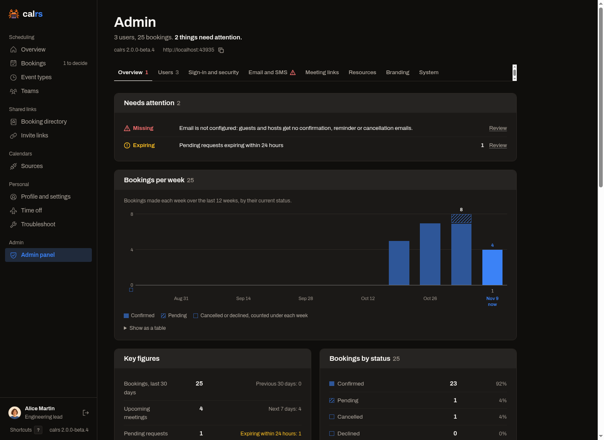
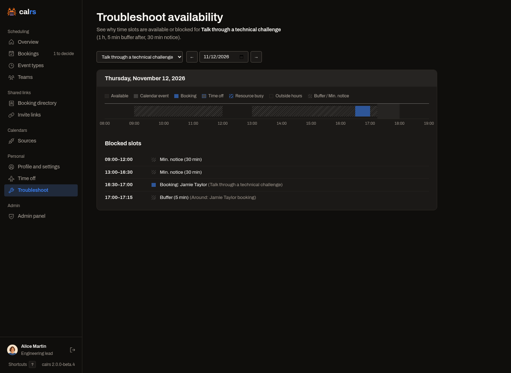
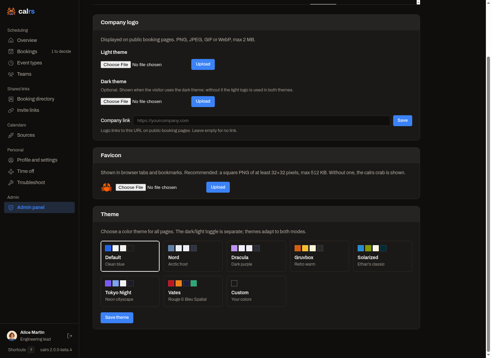

# Admin Dashboard

The admin dashboard is available at `/dashboard/admin` for users with the `admin` role.



The panel is organized into **Overview**, **Users**, **Sign-in and security**, **Email and SMS**, **Meeting links**, **Resources**, **Branding** and **System** tabs. The overview summarizes booking activity, users, calendar health and items needing attention. The remaining tabs group the configuration described below.

## User management

Lists all registered users with:

- Name, email, username
- Role (admin/user)
- Status (enabled/disabled)
- Teams and groups

Actions per user:

- **Promote/Demote** — toggle admin role
- **Enable/Disable** — control whether a user can log in or receive bookings
- **Delete** — permanently remove a user after confirmation; review the consequences shown before submitting
- **Impersonate** — view the dashboard as that user (for troubleshooting)

The server does the searching, filtering, sorting and paging, so the page
only ever carries 25 rows: press Enter to search, and use **Previous** and
**Next** under the table. Promoting, disabling or deleting a user brings you
back to the same page of the list.

The **Groups** list below it works the same way: search by name (press
Enter), 25 groups a page, and each group shows ten of its members, by
weight then name, with its own **Previous** and **Next** for the rest. The
two lists keep each other's page as you move through either.

On an instance with more than 20,000 bookings, the booking figures of the
overview (totals, the weekly chart and the 90-day rankings) are kept for a
minute rather than recomputed on every visit; the chart's note then says how
many seconds old they are. User
counts, calendar health and the attention list are always live. Smaller
instances never cache them.

## Impersonation

Admins can impersonate any user to troubleshoot their view:

1. Click **Impersonate** next to a user in the admin panel
2. You are redirected to the dashboard, viewing it as that user
3. A yellow banner at the top shows who you're impersonating
4. Click **Stop impersonating** to return to your own view

Impersonation uses a separate `calrs_impersonate` cookie (24-hour TTL). The real admin session is preserved.

## Availability troubleshoot

For each event type, the dashboard offers a **Troubleshoot** link that opens a visual timeline at `/dashboard/troubleshoot?event_type={event_type_slug}&date=YYYY-MM-DD` (both optional: your first event type and today otherwise):

- Shows availability and conflicts for the selected date
- Displays why each slot is blocked (calendar event name, existing booking, buffer overlap)
- Helps debug availability issues when users report incorrect free/busy status



## Authentication settings

- **Registration** — toggle open registration on/off
- **Allowed domains** — restrict registration to specific email domains (comma-separated) or allow any

## OIDC configuration

- **Enabled** — toggle SSO login on/off
- **Issuer URL** — your OIDC provider's base URL
- **Client ID** — the client ID registered with your provider
- **Client secret** — update the secret (current value is never displayed)
- **Auto-register** — automatically create users on first OIDC login

## Google OAuth2

Admin → Sign-in and security → Google OAuth2 holds the instance-wide Google client ID and secret used when users connect Google Calendar. The same credentials are used to attach a Google Meet conference to a confirmed booking when an event type uses the Google Meet location. There is no extra Meet admin form. See [Google Calendar](./google-calendar.md).

## Microsoft Calendar

The **Microsoft 365 / Outlook.com calendar** section of the **Sign-in and security** tab holds the instance-wide Microsoft Entra application client ID, client secret, and tenant used for delegated Microsoft Graph calendar access. Register the displayed callback as a **Web** redirect URI, paste the secret **Value** (not its ID), and track its expiry for rotation. Leaving the secret blank preserves its current encrypted value.

This connects Microsoft 365 and Outlook.com calendars; it does not configure calrs sign-in or **Microsoft Exchange on-premises (EWS)**. Users connect and consent from Sources outside impersonation mode. See [Microsoft Calendar](./microsoft-calendar.md) for app registration, permissions, tenant choices, calendar selection, and verification.

## Resources

The **Resources** card manages [shared bookable resources](./resources.md) (demo lab, meeting rooms): add a resource from its ICS feed URL, edit its optional CalDAV write-back settings and team allowlist, force a sync with **Sync now**, and verify write access with **Test write**. A failed feed sync is flagged here with the last error. See [Shared Resources](./resources.md) for details.

## SMS settings

The **SMS settings** card configures the instance's [SMS gateway](./sms.md): pick Twilio, GatewayAPI, seven.io, or a generic webhook, and the form relabels its fields for that vendor. The same card holds the daily limit (in billed segments, test messages included), today's messages, segments and cost, and the policy controlling whether non-admins may enable SMS on their own event types.

**Test gateway** sends a real message to a number you give it, or verifies the credentials for free when you leave the field empty and the gateway supports it.

SMS spends real money on a public form, so the card also warns when SMS is configured without a captcha. See [SMS Notifications](./sms.md) for the setup steps and for keeping the bill bounded.

## Guest email footer

The **Guest email footer** card sets the default footer added to every email guests and additional attendees receive (never to hosts, nor to a team member who claimed the booking). It takes bold, italic and links, at most 500 characters, in one text for all languages. An event type with a footer of its own uses that instead; see [Guest email footer](./event-types.md#guest-email-footer).

The checkbox on the card lets every user write footers on their own event types. It is off by default: the footer goes out under this instance's name, so only admins may write one until you turn it on.

## Branding

The **Branding** tab holds the company logo, the link it points to, the favicon and the theme.

Choose **Default**, **Nord**, **Dracula**, **Gruvbox**, **Solarized**, **Tokyo Night** or **Vates**. Every preset has a light and dark palette; visitors can switch modes or follow their system preference. **Custom** lets you set the accent, hover, background, surface and text colors for your organization.



The company logo is shown at the top of the public booking pages. Upload a PNG, JPEG, GIF or WebP image of at most 2 MB; SVG is refused. A second, optional logo is used when the visitor's page is in the dark theme, for a wordmark that would not read on a dark background. A light logo alone is shown in both themes; a dark logo alone is shown in the dark theme only, since a mark made for a dark background may not read on a light page. Each preview sits on the page background the instance theme gives public pages, light and dark, whatever theme your dashboard is in. A new logo shows to visitors on their next page view. Emails never carry the company logo.

## SMTP configuration

Open **Email and SMS > SMTP** to configure the server, port, TLS mode, optional credentials and sender identity, then send a test email. Settings take effect without a restart. Passwords are encrypted; leaving the password blank keeps the existing value. The same configuration is available through `calrs config smtp`.

For containers and managed deployments, use environment variables:

```text
CALRS_SMTP_HOST=smtp.example.com
CALRS_SMTP_PORT=587
CALRS_SMTP_TLS_MODE=starttls
CALRS_SMTP_USERNAME=calrs@example.com
CALRS_SMTP_PASSWORD=your-secret
CALRS_SMTP_FROM_EMAIL=calrs@example.com
CALRS_SMTP_FROM_NAME=Example Scheduling
```

Supply secrets through your deployment's secret mechanism. `CALRS_SMTP_HOST` and `CALRS_SMTP_FROM_EMAIL` are required when using environment configuration. The environment block overrides the stored settings as a whole, and the form indicates that it is managed by the environment. `starttls`, implicit `tls` (typically port 465) and `none` for a trusted local relay are supported. See [CLI Reference](./cli-reference.md#relaying-through-a-local-mta) for unauthenticated relays and certificate limitations.

Without SMTP, bookings still work, but approval messages, reminders, invitations and failure alerts cannot be delivered by email. Confirmed bookings still offer an `.ics` download.

## Integration policies

The admin panel controls whether ordinary users may use the REST API through personal tokens or OAuth, manage outgoing webhooks, enable SMS on their event types, or write guest email footers. These are separate policies, restricted to administrators by default. Enabling one does not grant another, or grant access to other users' bookings.

Use [REST API](./api.md), [MCP](./mcp.md), [Webhooks](./webhooks.md) and [SMS](./sms.md) for their scopes, credentials and revocation behavior. The **Sign-in and security** tab also configures [organization-wide Exchange calendars](./ews-impersonation.md).

## Meeting links

Configure the default Jitsi URL pattern or a meeting-provider webhook under the meeting settings. Event types choose a static link, generated Jitsi room, webhook-generated URL or Google Meet as their location. Google Meet uses the connected host's Google Calendar credentials; it has no separate client configuration. See [Locations](./event-types.md#location).

## Booking captcha

The optional Cap proof-of-work captcha protects booking submissions. Configure the Cap instance URL, site key and secret, then optionally provide the widget script and WASM URLs. Those asset URLs default to an external CDN when left unset: configure self-hosted URLs when you want the whole guest flow served from infrastructure you control. Changes apply without restarting calrs. This is separate from login and booking rate limits.

## System settings

Set the public base URL, private-host allowlist and trusted proxies for your deployment. Environment variables take precedence and make the corresponding controls read-only. See [Deployment](./deployment.md#environment-variables) and [Security](./security.md#trusted-proxies).

The site default first weekday affects calendar presentation, while each user and event type can override it. The German form-of-address policy selects informal or formal German for visitors whose browsers request German.
