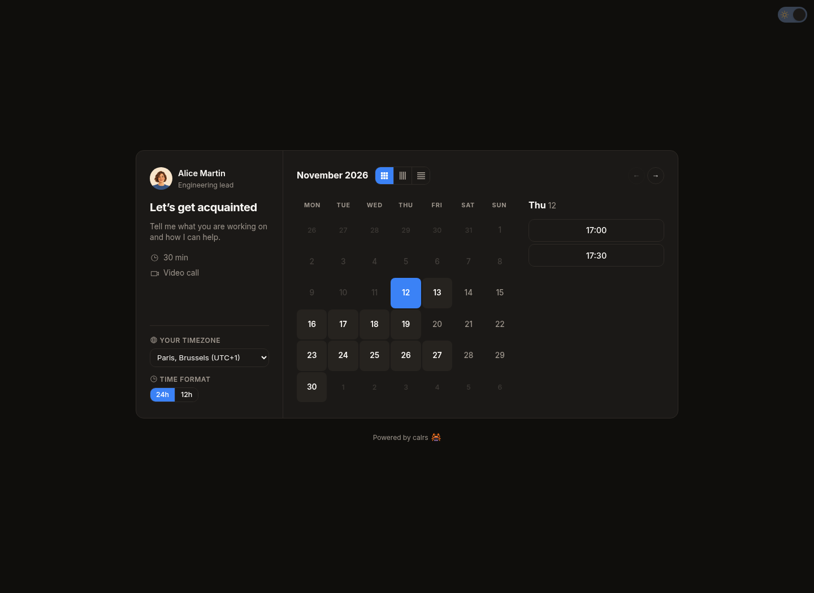
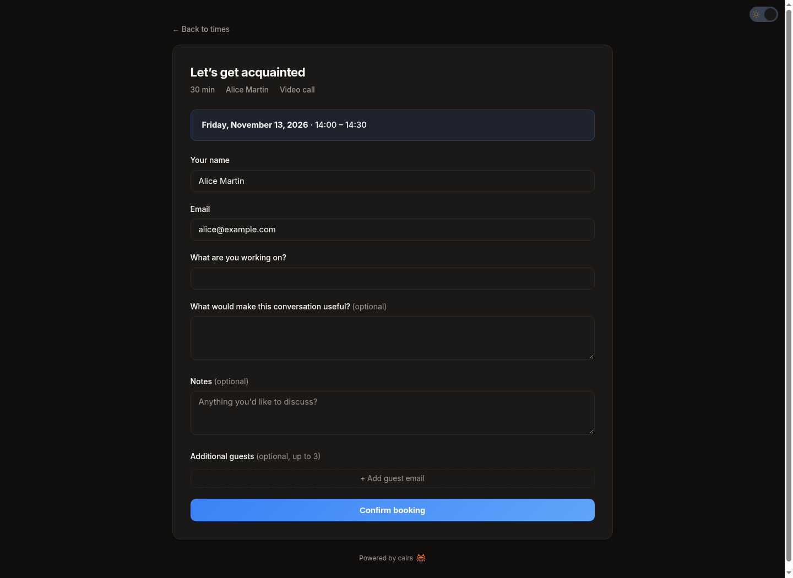

# Booking Flow

## Guest experience

A host's page (`/u/{username}`) and a team's page (`/team/{slug}`) list their public meetings in cards. Beside the host's name (under it on narrow screens), only what is set: the usual hours as a small timetable under a heading naming the timezone once ("Usually available, Paris time", then rows such as "Mon to Thu 09:00 to 17:30"; for each day, the earliest start to the latest end among the weekly hours of the meetings listed, an approximation that hides breaks; more than four schedules say the hours vary by day; on a team page, from the team's meetings only, not the members' own hours), with a "My time" button that shows the rows in the visitor's timezone when it differs, then where the host is based and the languages they speak on one line (Profile & Settings). Without sections, one "Meetings" card lists every meeting; when meetings have a section (set in the event type form), each section is a card of its own, in the order the host sets at **Event types > Change the order** (`/dashboard/event-types/order`; a team's at `/dashboard/teams/{id}/order`, for team admins), and meetings without one come last under "Other meetings". Each meeting shows its length (as small clock faces and in words), how the guest meets (video, phone or in person) and "Host confirms" when the host confirms each request. A line above the cards explains how booking works when there is more than one meeting.

1. **Visit the booking page** — `/u/host/meeting-slug` (or via an invite link for private event types, or `/u/host+other/slug` for [dynamic group links](./event-types.md#dynamic-group-links))
2. **Pick a timezone** — auto-detected from the browser, changeable via dropdown
3. **Browse available slots** — displayed as a week view, navigate with Previous/Next buttons
4. **Click a slot** — opens the booking form
5. **Fill in details** — name, email, optional notes (pre-filled from invite if applicable)
6. **Add guests** — optionally invite additional attendees (if the event type allows it)
7. **Submit** — booking is created
8. **Confirmation page** — shows booking summary (including any additional attendees)
9. **Email** — guest and any additional attendees receive a confirmation email with an `.ics` calendar invite attached





## Timezones and existing installations

New bookings store UTC timestamps. Availability rules remain in the event type's
IANA timezone, and guests see times in their selected timezone. The dashboard
uses the host's profile timezone. Changing those settings does not move a new
booking's actual start or end time; the server's timezone does not determine it.
The CLI interprets `booking create --date ... --time ...` in `--timezone` (UTC by
default), then checks availability in the event timezone.

Upgrading adds a storage-version field automatically. Existing bookings retain
their original timestamps and legacy interpretation: there is no bulk conversion,
manual migration, notification, or calendar rewrite. Historical timezone mistakes
are not repaired automatically. Rescheduling an existing booking stores the
newly selected time in UTC; cancelling it leaves its timestamps unchanged.

Back up the database before upgrading as usual. Older binaries do not understand
the new storage format; reverting to one after creating UTC bookings requires
restoring the pre-upgrade backup, which loses bookings created since that backup.

Ambiguous or nonexistent local start times during daylight-saving transitions
are rejected instead of silently choosing an instant. Calendar attachments for
new bookings carry both exact UTC endpoints, including across midnight and clock
changes. Meeting-provider webhooks likewise receive explicit UTC timestamps for
new bookings (legacy bookings retain the previous format).

### Clock changes

Durations and minimum notice use elapsed time. The slot picker omits nonexistent
or ambiguous local starts, since booking forms do not carry a DST-fold marker.
Conflict checks retain the existing wall-clock availability engine: a UTC booking
that crosses a backward clock change blocks a conservative envelope covering both
occurrences of the repeated hour. This can hide otherwise free slots around the
transition, but prevents a reversed local interval from allowing double-booking.
Host email text and calendar attachments use the exact UTC endpoints for new rows.


## Booking statuses

| Status | Description |
|---|---|
| `confirmed` | Booking is active. Slot is blocked. Emails sent. |
| `pending` | Awaiting host approval (when `requires_confirmation` is on). Blocks the slot unless the event type turns that off. |
| `cancelled` | Cancelled by host or guest. Slot is freed. |
| `declined` | Declined by host, or expired before the host answered. |

## Confirmation mode

When an event type has **requires confirmation** enabled:

1. Guest submits booking → status is `pending`
2. Guest receives a "pending" email (no `.ics` yet)
3. Host receives an "approval request" email with **Approve** and **Decline** buttons
4. Host can approve/decline in two ways:
   - **From the email** — click the Approve or Decline button (no login required, token-based)
   - **From the dashboard**: in the **Waiting for your decision** section of the bookings page, click Confirm or Decline
5. On confirm: status becomes `confirmed`, guest receives confirmation email with `.ics`, booking is pushed to CalDAV. Auto meeting links (Jitsi, webhook, Google Meet) are generated at this moment, not while the booking is pending.
6. On decline: status becomes `declined`, guest receives a decline notification with optional reason

Before confirming, both approval paths check that the host is still free at that time (the assigned member for round-robin, every member for collective): a calendar event or a confirmed booking that appeared in the meantime makes the approval fail with an explanation instead of double-booking the host. Other pending requests do not count here, so when two requests overlap the host can approve either one; the other is then refused.

### Pending requests hold the slot

By default a pending request blocks its host's time exactly like a confirmed booking: the slot disappears from the booking page, and overlapping slots on the host's other event types disappear too, so a second guest is never offered a time that is already requested. Uncheck **Pending requests block the time slot** in the event type form to let other guests request the same time (the first approved wins; the database still refuses two bookings on the exact same slot).

### Request expiry

**Request expiry** (never, 4, 24, 48 or 72 hours; 24 for new event types, never for event types that existed before the setting) bounds how long a request may wait. The deadline is set when the request is made. It never runs later than the latest moment another guest could still book the slot (start minus the minimum notice), since expiring after that point frees nothing. A request made inside that window (the guest booked right at the minimum notice) keeps the expiry, capped by the meeting start, rather than lapsing minutes later. A guest reschedule that puts the booking back to pending restarts it.

- Halfway to the deadline, the host gets one reminder with the Approve and Decline buttons.
- At the deadline the request is **declined, never accepted**. The guest receives an email in the language they booked in (and an SMS when the event type collects phone numbers) asking them to pick another time, with a link to the booking page when the event type is public and `CALRS_BASE_URL` is set. The host gets a short notice.

The check runs in the same background task as reminders, once a minute.

> **Note:** The email action buttons require `CALRS_BASE_URL` to be set. Without it, the host must use the dashboard.

## Cancellation

From the dashboard, click **Cancel** on an upcoming booking:

1. Optionally enter a reason
2. Confirm the cancellation
3. Both guest and host receive cancellation emails with a `METHOD:CANCEL` `.ics` attachment
4. If the booking was pushed to CalDAV, the event is deleted from the calendar

### Guest self-cancellation

Guests can cancel their own bookings via a link in the confirmation email:

1. Click the "Cancel booking" link in the email
2. Optionally enter a reason
3. Confirm the cancellation
4. Both guest and host are notified

The cancellation email correctly attributes who cancelled (host vs guest).

## Reschedule

Bookings can be rescheduled without cancelling and rebooking. Both guests and hosts can initiate a reschedule.

### Guest reschedule

Guests can reschedule their booking via the reschedule link in the confirmation or pending email:

1. Click the "Reschedule" button in the email
2. Pick a new time slot from the slot picker (the current booking's slot is freed so it remains available)
3. Confirm the new time
4. The booking moves to `pending` status — the host must approve via email or dashboard. The request expiry starts over from the reschedule.
5. If the booking was previously pushed to CalDAV, the event is removed (re-pushed on approval)

### Host reschedule

Hosts can reschedule from the dashboard:

1. Go to **Dashboard > Bookings** and click **Reschedule** on a booking
2. Pick a new time slot
3. Confirm the new time
4. The booking stays `confirmed` — no approval needed
5. The CalDAV event is updated in place (same UID). Google Meet bookings keep the existing Meet link; only the event times are patched.
6. The guest receives a reschedule notification with the updated `.ics` invite

### Token regeneration

After each reschedule, the `reschedule_token`, `cancel_token`, and `confirm_token` are regenerated. This invalidates any previous email links, ensuring only the latest links work.

### Edge cases

- **Already cancelled/declined bookings** cannot be rescheduled (error page shown)
- **Self-conflict** is handled: the booking being rescheduled doesn't block its own new slot
- **Group bookings** keep the original `assigned_user_id` (no re-running round-robin)
- **Reminder state** is reset: `reminder_sent_at` is cleared so a new reminder is sent for the updated time

## Notice window policy

By default, guests can cancel or reschedule via their tokenized email links at any time, including a few minutes before the meeting starts. This leaves hosts with same-day calendar holes that cannot be re-filled.

Per event type, you can require a minimum lead time before guests can take either action:

- **Minimum notice to cancel** — gates `/booking/cancel/{token}` (both the form and the submission).
- **Minimum notice to reschedule** — gates `/booking/reschedule/{token}` (both the slot picker and the submission).

Each is set from the event type form with a numeric value plus a unit selector (minutes / hours / days). Empty means no restriction (the previous behaviour).

Within the configured window, the guest sees a friendly page showing the host's contact email instead of a working form. The booking is unchanged. If the policy is set, it is also surfaced inline on the confirmation page and in the confirmation email so the guest is warned upfront.

The check applies to **guest-side actions only**. Hosts and admins can still cancel or reschedule from the dashboard at any time, since real-world emergencies often require host action on behalf of the guest. The notice window is not enforced on host paths.

## Host notes

Each booking can carry **host notes**: free text for the people running the meeting (what was said on a call, what to prepare), kept apart from the notes the guest typed when booking. Open them from the booking's title on the bookings page or the overview, at `/dashboard/bookings/{id}/notes`. Once a booking has notes, its row shows them with an **Edit note** button (the overview's agenda shows a quiet "Host note" marker instead). For notes after the call, the bookings page lists in **Last 30 days** the meetings held over that time, and in **Cancelled and declined** the bookings that were cancelled or declined, from those due 30 days ago to those cancelled for a later date, for each of their hosts. Each title opens the notes, so a note on a meeting cancelled for next month stays reachable. Each section of the bookings page (waiting for a decision, available to claim, upcoming, last 30 days, cancelled and declined) shows 50 bookings a page with its own **Previous** and **Next**, and moving through one section leaves the others on their page. The search box searches every section and page on the server when you press Enter (guest name, email, meeting title, and the team for bookings you can claim), and an action taken on a page (cancel, approve, decline, ask to reschedule) brings you back to that page. Notes are counted in characters, an emoji being one. The page shows the booking, the guest's own notes, and who last edited the host notes and when. Notes are at most 5000 characters; saving an empty field removes them.

Who can read and edit them:

| Person | Access | Why |
|---|---|---|
| Owner of the event type (its creator, for a team event type) | Yes | Sees the booking on their bookings page and approves, cancels or reschedules it |
| Member a round-robin booking is assigned to | Yes | Runs the meeting |
| Every member of a collective booking | Yes, except members excluded from the event type | They all attend |
| Members of a round-robin team, when the booking has no assigned member (deleted account, old booking) | No, only the owner | It was never theirs |
| Watcher who claimed the booking | Yes | Took the meeting over |
| Other members of a round-robin team, team admins who are none of the above, watchers only offered the booking, instance admins | No | Nothing else in calrs shows them that booking |

Access follows the team as it is now: a member who leaves the team loses access to its collective bookings. Anyone else gets the dashboard's "Not found" page, also when saving, whether or not the booking exists. When two hosts edit at the same time, the second save is refused with the first one's text shown (or "(cleared)"), so nothing is overwritten silently. An admin impersonating a host is recorded as the author: "Last edited by Admin (admin, as Host)".

Host notes are shown on host surfaces only: the notes page, the bookings page, the overview, and the host emails sent once they exist (host reminder, approval reminder, "booking confirmed", cancellation and reschedule request). Each host email checks its own recipient: a collective booking's organizer who has since left the team still gets the email (the calendar event names them) but without the notes. They are **never** shown to the guest: not on the confirmation page or the cancel and reschedule pages, not in guest emails or SMS, not in an `.ics` file, a webhook or an embed. They are not written into the calendar event either, since calendar servers send that event to its attendees and it is often shared.

Notes stay with the booking when it is rescheduled, and when it is cancelled or declined.

## Conflict detection

Before a booking is accepted, calrs checks for conflicts:

- **Calendar events** — from synced CalDAV sources
- **Existing bookings** — confirmed bookings on any event type
- **Buffer times** — the buffer before/after is included in the conflict window
- **Minimum notice** — slots too close to the current time are rejected

Additionally, a database-level unique index prevents two bookings from occupying the same slot, even if two guests submit simultaneously. On round-robin team event types the uniqueness is per assigned member, so two guests can book the same time as long as different members take the bookings.

## CalDAV write-back

When a booking is confirmed (either directly or via approval), calrs can push the event to the host's CalDAV calendar. For team event types the host is the assigned member (round-robin), or every eligible member (collective: enabled members with a non-zero per-event-type weight, the same set the slot grid checks). See [CalDAV Integration > Write-back](./caldav.md#caldav-write-back) for setup.

The event's `ORGANIZER` is the host: the assigned member, or for a collective booking the first eligible member by name, with every member's name joined. A collective or dynamic group booking stores that organizer when it is created and keeps it for every later update (approval, reschedule, claim, retry), even if the team changes in the meantime: Google CalDAV refuses an update that changes an existing event's organizer. Bookings made before calrs stored it (migration 070) still resolve it from the current roster.

## Email notifications

If SMTP is configured, calrs sends emails at these moments:

| Event | Guest receives | Host receives |
|---|---|---|
| Booking confirmed | Confirmation + `.ics` REQUEST | Notification + `.ics` REQUEST |
| Booking pending | "Awaiting confirmation" notice | Approval request with Approve/Decline buttons |
| Booking declined | Decline notice (with optional reason) | — |
| Booking cancelled | Cancellation + `.ics` CANCEL | Cancellation + `.ics` CANCEL |
| Booking rescheduled (by host) | Reschedule notification + updated `.ics` | — |
| Reschedule request (by guest) | "Pending" notice with updated time | Reschedule approval request with Approve/Decline buttons |
| Booking reminder | Reminder with cancel button | Reminder with details |
| Invite sent | Invite email with booking link | — |

All emails are sent as **HTML with plain text fallback**. They include event title, date, time, timezone, location, and notes. The HTML templates are responsive and support dark mode in email clients that honor `prefers-color-scheme`.

### Email language

Every email is written in its reader's language, in any of the languages calrs ships:

- **Guests** (and the additional attendees they add) get the language the booking page was shown in when they booked, whoever triggers the email. That is the guest's browser language, unless the host chose **Always my language** under **Public booking page language** in Profile & Settings: their own booking pages (`/u/{username}`, and the legacy `/{slug}` routes), and so their guests' emails, then use the host's own saved language. Being logged in to calrs does not change the language of a booking page: it follows the browser the booking is made from, so a staff member booking on a client's behalf books in their own browser's language, not their saved calrs preference. To reach a client in another language, book from a browser set to it, or send the client the booking link. The email goes out whoever triggers it: the guest themselves, the host approving, declining, cancelling or asking for a new time, the reminder task, or a calendar sync noticing the host deleted the event.
- **Hosts, team members and watchers** get the language they chose in **Profile & Settings**. With none set, they get English. On a collective team booking each member receives the host email in their own language.
- The guest's cancel and reschedule pages use that same language, so they match the emails. The host's approve and decline pages use the host's saved language (for a collective booking, which several members can approve, the browser's), and claim pages the watcher's.
- **Invites** follow the language of the person sending them, who also writes the optional personal message.

The admin SMTP test email is English.

### Sender and replies

Every email leaves from the configured sender address, so SPF, DKIM and DMARC keep aligning with the instance's domain. What changes is the name the guest sees and where their reply goes:

- **Guest emails** (confirmation, the copies to additional attendees, pending, reminder, cancellation, decline, expired request, pick a new time, reschedule, invite) show the host's name followed by the configured sender name, joined in the email's language: `Bob Smith via Acme Scheduling`, or just `Bob Smith` when no sender name is set. They carry a `Reply-To` with the host's booking email (their account email when no booking email is set), so a guest who answers the email reaches the host directly.
- On a round-robin booking the host is the assigned member. On a collective or dynamic group booking the name is the joined roster (`Alice & Bob via ...`), and replies go to the member the calendar invite names as organizer, the same on every email of that booking even when the team changes after it was made, and whoever cancels, declines or reschedules it. Bookings made before migration 070 have no stored organizer and still resolve it from the current roster, so a team change can move theirs.
- **Invites** take the `Reply-To` from the inviting user's account email, never their booking email: the inviter picks the recipients, and the booking email is not verified.
- **Host, team member, watcher and admin emails** keep the configured sender name and have no `Reply-To`.

A host whose booking email is on a free-mail domain while the instance sends from its own domain may see some guest emails scored higher by spam filters (SpamAssassin's `FREEMAIL_FORGED_REPLYTO`). A booking email on the organization's domain avoids it.

## Timezone handling

- Guest's timezone is auto-detected via `Intl.DateTimeFormat` in the browser
- A timezone dropdown lets the guest change it
- Slots are displayed in the guest's selected timezone
- New bookings use UTC storage. Legacy bookings retain their existing timezone interpretation.
- The timezone is preserved across navigation (week picker, booking form)

## CLI booking

```bash
calrs booking create intro \
  --date 2026-03-20 --time 14:00 \
  --name "Jane Doe" --email jane@example.com \
  --timezone Europe/Paris --notes "Let's discuss the project"
```
