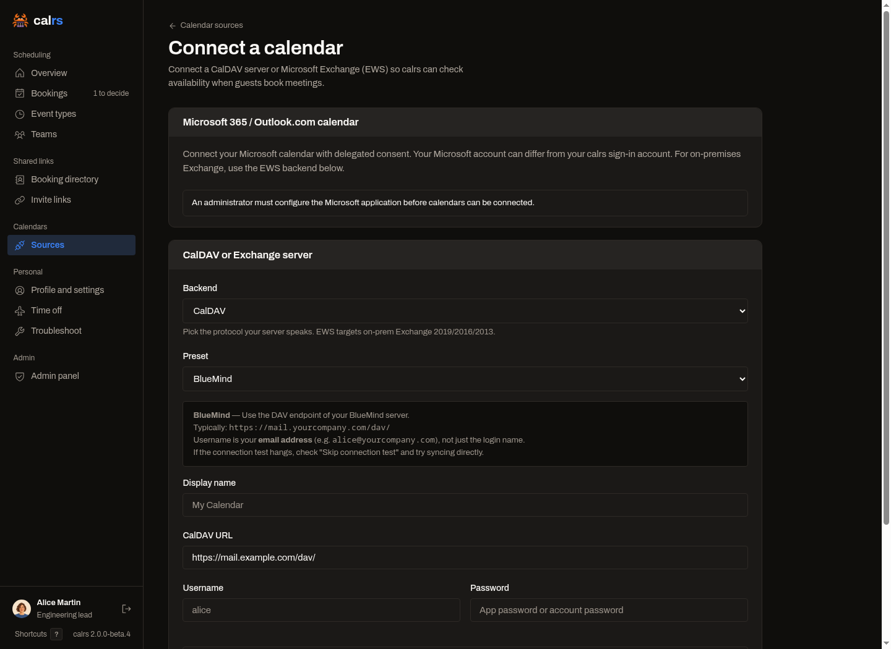

# CalDAV Integration

calrs connects to any CalDAV server to read your calendar for free/busy computation and optionally write confirmed bookings back.

## Connecting a calendar source

### From the web dashboard

1. Go to **Dashboard > Calendar sources > + Add**
2. Select your provider (BlueMind, Nextcloud, Fastmail, Baikal, etc.) — the URL is auto-filled
3. Enter your username and password
4. Click **Add source**

The connection is tested automatically before saving. Use "Skip connection test" if your server doesn't respond to OPTIONS requests (e.g., BlueMind).



### From the CLI

```bash
calrs source add --url https://nextcloud.example.com/remote.php/dav \
                 --username alice --name "Work Calendar"

# Skip connection test if needed
calrs source add --url https://mail.company.com/dav/ \
                 --username alice --name "BlueMind" --no-test
```

## Provider URLs

| Provider | CalDAV URL |
|---|---|
| BlueMind | `https://mail.yourcompany.com/dav/` |
| Nextcloud | `https://cloud.example.com/remote.php/dav` |
| Fastmail | `https://caldav.fastmail.com/dav/calendars/user/you@fastmail.com/` |
| iCloud | `https://caldav.icloud.com/` |
| Zimbra | `https://mail.example.com/dav/` |
| SOGo | `https://mail.example.com/SOGo/dav/` |
| Radicale | `https://cal.example.com/` |
| Baikal | `https://cal.example.com/dav.php/` |

> **Tip:** Use app-specific passwords for Fastmail and iCloud.

### Google Calendar

Google Calendar connects via OAuth2, not a username/password. See [Google Calendar](./google-calendar.md) for Cloud project setup, scopes, and [Google Meet auto-links](./google-calendar.md#google-meet-auto-links).

### Microsoft calendars

[Microsoft 365 / Outlook](./microsoft-calendar.md) uses native Microsoft Graph with OAuth2, not CalDAV. It is separate from **Microsoft Exchange on-premises (EWS)**.

## Auto-discovery

calrs follows the CalDAV standard (RFC 4791) for discovery:

1. **PROPFIND** on the base URL to find the `current-user-principal`
2. **PROPFIND** on the principal to find the `calendar-home-set`
3. **PROPFIND** on the calendar home to list all calendars
4. Filters to actual `calendar` collections (skips inbox, outbox, tasks, etc.)

## Syncing

```bash
# Sync all sources
calrs sync

# Full re-sync (ignore sync tokens)
calrs sync --full
```

From the dashboard, click **Sync** on any source to trigger a sync.

Sync pulls all VEVENT data from your calendars and stores it in the local SQLite database. Events are upserted by UID (and RECURRENCE-ID for modified instances), so re-syncing is safe.

### Choosing which calendars are synced

Some servers (Kerio Connect, for instance) list every calendar the account subscribed to, colleagues' calendars included. Click **Calendars** on a source to pick the ones calrs syncs. An unchecked calendar is still listed, but its events are never fetched, its cached events are dropped at once, and it never blocks availability. Newly discovered calendars are synced until you uncheck them. A calendar does not need to be synced to receive bookings through write-back.

```bash
# List a source's calendars
calrs source calendars <id-prefix>

# Stop syncing one, sync another (calendar ID prefix, href or display name)
calrs source calendars <id-prefix> --disable "Colleague" --enable "Personal"
```

The **Conflict calendars** section of an event type then picks, among the synced calendars, the ones that count for that event type. If none of the calendars it picked is synced any more, it falls back to every synced calendar, as when it picks none, so turning calendars off never leaves an event type with no conflicts at all.

### Multi-VEVENT resources

Some CalDAV servers (notably BlueMind) bundle recurring events and their modified instances into a single CalDAV resource containing multiple VEVENTs. calrs splits these and stores each VEVENT as a separate row:

- The **parent event** has the RRULE and is stored with its UID
- **Modified instances** have a RECURRENCE-ID and are stored alongside the parent with a composite unique key `(uid, recurrence_id)`
- This ensures modified occurrences correctly block (or free) availability

Recurring events are expanded over the window asked for, however long ago the series started: a daily stand-up created years ago still blocks today. Supported rules are `DAILY`, `WEEKLY`, `MONTHLY` and `YEARLY`, with `INTERVAL`, `UNTIL`, `COUNT`, `BYDAY`, `BYMONTH`, `BYMONTHDAY`, `BYSETPOS`, `WKST`, `RDATE` (extra dates, with or without a rule) and `EXDATE`; cancelled occurrences count toward `COUNT`, as RFC 5545 says. A rule calrs cannot expand is never read as free: an hourly one or one with `BYHOUR` blocks every slot from its start, any other (`BYYEARDAY`, `BYWEEKNO`, `RSCALE`) the event's own time every day from its start, up to its `UNTIL`; the troubleshoot view shows it as a repeat rule calrs cannot read, and each sync logs a warning.

## CalDAV write-back

When a booking is confirmed, calrs can automatically push it to your CalDAV calendar as a VEVENT. When a booking is cancelled, the event is deleted.

### Setup

1. Sync your calendar source at least once (so calrs knows which calendars exist)
2. On the dashboard, find your source under "Calendar sources"
3. Use the **"Write bookings to"** dropdown to select which calendar should receive bookings
4. Select "None" to disable write-back

### How it works

- On **confirmation**: calrs generates an ICS event and PUTs it to `{calendar-href}/{booking-uid}.ics`
- On **cancellation**: calrs DELETEs the event from the same path
- The booking tracks which calendar it was pushed to, so cancellation always targets the right calendar
- Each event type can send its bookings to a calendar of its own (see below)
- If no write calendar is configured, write-back is skipped and a warning is logged (emails still work)
- Write-back works for individual bookings, team bookings (the assigned member's calendar for round-robin, every eligible member's for collective), and pending-then-confirmed bookings

### Per event type: "Write confirmed bookings to"

The source setting above applies to every booking. To send one event type's bookings somewhere else (coaching into a personal calendar, team calls into a shared work calendar), choose a calendar for it:

- **Personal event types**: in the event type form, under **Booking options**, pick a calendar in **"Write confirmed bookings to"**.
- **Any event type you host, team ones included**: on the **Calendar sources** page, the **"Bookings by event type"** section lists your event types with one dropdown each. On a team event type each member chooses their own calendar, since it is the assigned member's (or, for collective, each member's) own calendar that receives the booking. The team event type form points there.

The list offers every calendar of your own enabled sources, synced or not, like the source setting. **"Default (source setting)"** keeps the behaviour above. A chosen calendar receives that event type's bookings instead of the write calendar of each source, not in addition to it.

What happens when things change:

- **The choice changes** while a booking is upcoming: the booking moves at its next write (a reschedule, an approval, a retry, a claim). The new copy is written first; the copy left in the earlier calendar is deleted only once that write has landed, so a failed write never leaves the booking without a calendar. Cancelling a booking deletes it from the calendar it was actually written to, and a delete that fails is tried again in the background.
- **The calendar refuses the booking for good** (deleted on the server, or read-only: HTTP 403, 404 or 405): the booking is written to the source setting instead, without a failure or retries, and the Calendar sources page shows the refusal next to the event type. The next booking tries the chosen calendar again.
- **The calendar's source is disabled**: bookings go back to the source setting until it is enabled again. The choice stays, shown as "(unavailable)", and saving the form unchanged keeps it. **The source is removed**: the choice is removed with it.
- **Google Meet**: the Meet event is created on the chosen calendar when it is a calendar of your Google account, otherwise on your Google source's write calendar, as before. Once created it never moves, since that event holds the meeting.
- The orphan check (a booking cancelled because its event was deleted from your calendar) also covers a chosen calendar, when it is synced.

### When a write-back fails

After each PUT, calrs reads the event back by UID (HEAD, or PROPFIND on servers that refuse HEAD; FindItem on EWS). A write the server refused, or accepted without the event becoming readable, counts as failed.

The booking stays confirmed: the slot is already blocked by calrs's own bookings table and the guest already has the invitation, so refusing the booking after the fact would only leave the guest with an invite to a meeting that no longer exists. Instead:

- the failure is recorded on the booking, and the bookings dashboard shows a **"not in your calendar"** badge with the error
- the background task of `calrs serve` retries it, for confirmed bookings that have not started yet: 5 min, 15 min, 30 min, 1 h, 2 h, 4 h and 8 h after the previous attempt, then it stops. A retry replaces the same event (the PUT is keyed on the booking UID), so retrying never duplicates it, and a cancelled booking is never retried
- after three failed attempts (about 20 minutes) the host is emailed once, in their language, so they can add the event by hand. Retries carry on afterwards; a successful write clears the badge

## When a sync fails

If a source cannot be synced (server down, password changed, OAuth access revoked), calrs keeps offering slots from the last successful sync rather than refusing every booking. The failure is not silent:

- the calendar sources page shows the error and since when the source has been failing
- once a source has failed at least 3 times in a row over more than an hour, its owner is emailed once, in their language. They hear about it again only if it recovers and later fails again
- a calendar that fails to fetch fails the sync of its source, so "Sync complete." means every calendar synced
- an answer calrs cannot read counts as a failure too: an error status (a 500 or 503, even with an empty body), malformed XML, or a page that is not a WebDAV answer at all (a proxy's HTML error page). The error says which ("returned 503", "malformed XML at byte ...", "expected a WebDAV multistatus"). The calendar keeps its cached events and is fetched again on the next sync, instead of being read as an empty calendar that has not changed
- a single answer from the server is read up to 64 MB, which covers calendars with tens of thousands of events; a bigger one, or one with more than a million XML elements, fails the sync of that calendar, to keep memory use bounded on small servers (at the limits, reading an answer takes a few hundred MB at most)
- error messages name the HTTP status only, never the text of the server's answer, since on a shared calendar it can quote other people's events
- slot pages retry a failing source at most every five minutes, so a dead server does not slow down every page load
- `calrs sync` lists the sources that failed and exits with status 1

## Managing sources

```bash
# List all sources
calrs source list

# Test a connection
calrs source test <id-prefix>

# Remove a source (cascade-deletes calendars and events)
calrs source remove <id-prefix>
```

From the dashboard: **Sync**, **Test**, and **Remove** buttons are available for each source.

## Credentials

Passwords are hex-encoded and stored in the SQLite database. This is not encryption — it prevents accidental display in logs but does not protect against database access. Secure your data directory appropriately.
