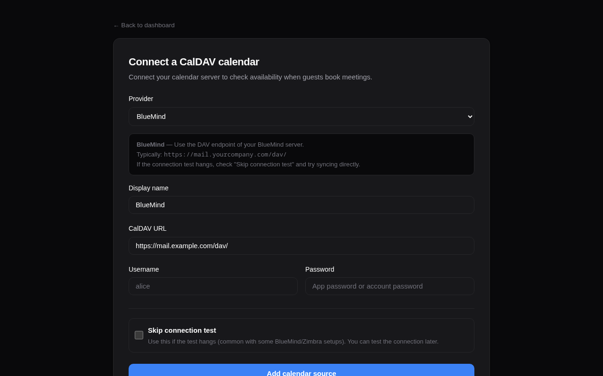

# CalDAV Integration

calrs connects to any CalDAV server to read your calendar for free/busy computation and optionally write confirmed bookings back.

## Connecting a calendar source

### From the web dashboard

1. Go to **Dashboard > Calendar sources > + Add**
2. Select your provider (BlueMind, Nextcloud, Fastmail, etc.) — the URL is auto-filled
3. Enter your username and password
4. Click **Add source**

The connection is tested automatically before saving. Use "Skip connection test" if your server doesn't respond to OPTIONS requests (e.g., BlueMind).



### From the CLI

```bash
calrs source add --url https://nextcloud.example.com/remote.php/dav \
                 --username alice --name "Work Calendar"

# Skip connection test if needed
calrs source add --url https://mail.company.com/dav/ \
                 --username alice --name "BlueMind" --no-test
```

## Provider URLs

| Provider | CalDAV URL |
|---|---|
| BlueMind | `https://mail.yourcompany.com/dav/` |
| Nextcloud | `https://cloud.example.com/remote.php/dav` |
| Fastmail | `https://caldav.fastmail.com/dav/calendars/user/you@fastmail.com/` |
| iCloud | `https://caldav.icloud.com/` |
| Zimbra | `https://mail.example.com/dav/` |
| SOGo | `https://mail.example.com/SOGo/dav/` |
| Radicale | `https://cal.example.com/` |

> **Tip:** Use app-specific passwords for Fastmail and iCloud.

### Google Calendar

Google Calendar connects via OAuth2, not a username/password. See [Google Calendar](./google-calendar.md) for Cloud project setup, scopes, and [Google Meet auto-links](./google-calendar.md#google-meet-auto-links).

### Microsoft calendars

[Microsoft 365 / Outlook](./microsoft-calendar.md) uses native Microsoft Graph with OAuth2, not CalDAV. It is separate from **Microsoft Exchange on-premises (EWS)**.

## Auto-discovery

calrs follows the CalDAV standard (RFC 4791) for discovery:

1. **PROPFIND** on the base URL to find the `current-user-principal`
2. **PROPFIND** on the principal to find the `calendar-home-set`
3. **PROPFIND** on the calendar home to list all calendars
4. Filters to actual `calendar` collections (skips inbox, outbox, tasks, etc.)

## Syncing

```bash
# Sync all sources
calrs sync

# Full re-sync (ignore sync tokens)
calrs sync --full
```

From the dashboard, click **Sync** on any source to trigger a sync.

Sync pulls all VEVENT data from your calendars and stores it in the local SQLite database. Events are upserted by UID (and RECURRENCE-ID for modified instances), so re-syncing is safe.

### Multi-VEVENT resources

Some CalDAV servers (notably BlueMind) bundle recurring events and their modified instances into a single CalDAV resource containing multiple VEVENTs. calrs splits these and stores each VEVENT as a separate row:

- The **parent event** has the RRULE and is stored with its UID
- **Modified instances** have a RECURRENCE-ID and are stored alongside the parent with a composite unique key `(uid, recurrence_id)`
- This ensures modified occurrences correctly block (or free) availability

## CalDAV write-back

When a booking is confirmed, calrs can automatically push it to your CalDAV calendar as a VEVENT. When a booking is cancelled, the event is deleted.

### Setup

1. Sync your calendar source at least once (so calrs knows which calendars exist)
2. On the dashboard, find your source under "Calendar sources"
3. Use the **"Write bookings to"** dropdown to select which calendar should receive bookings
4. Select "None" to disable write-back

### How it works

- On **confirmation**: calrs generates an ICS event and PUTs it to `{calendar-href}/{booking-uid}.ics`
- On **cancellation**: calrs DELETEs the event from the same path
- The booking tracks which calendar it was pushed to, so cancellation always targets the right calendar
- If no write calendar is configured, write-back is skipped and a warning is logged (emails still work)
- Write-back works for individual bookings, team bookings (the assigned member's calendar for round-robin, every eligible member's for collective), and pending-then-confirmed bookings

### When a write-back fails

After each PUT, calrs reads the event back by UID (HEAD, or PROPFIND on servers that refuse HEAD; FindItem on EWS). A write the server refused, or accepted without the event becoming readable, counts as failed.

The booking stays confirmed: the slot is already blocked by calrs's own bookings table and the guest already has the invitation, so refusing the booking after the fact would only leave the guest with an invite to a meeting that no longer exists. Instead:

- the failure is recorded on the booking, and the bookings dashboard shows a **"not in your calendar"** badge with the error
- the background task of `calrs serve` retries it, for confirmed bookings that have not started yet: 5 min, 15 min, 30 min, 1 h, 2 h, 4 h and 8 h after the previous attempt, then it stops. A retry replaces the same event (the PUT is keyed on the booking UID), so retrying never duplicates it, and a cancelled booking is never retried
- after three failed attempts (about 20 minutes) the host is emailed once, in their language, so they can add the event by hand. Retries carry on afterwards; a successful write clears the badge

## When a sync fails

If a source cannot be synced (server down, password changed, OAuth access revoked), calrs keeps offering slots from the last successful sync rather than refusing every booking. The failure is not silent:

- the calendar sources page shows the error and since when the source has been failing
- once a source has failed at least 3 times in a row over more than an hour, its owner is emailed once, in their language. They hear about it again only if it recovers and later fails again
- a calendar that fails to fetch fails the sync of its source, so "Sync complete." means every calendar synced
- slot pages retry a failing source at most every five minutes, so a dead server does not slow down every page load
- `calrs sync` lists the sources that failed and exits with status 1

## Managing sources

```bash
# List all sources
calrs source list

# Test a connection
calrs source test <id-prefix>

# Remove a source (cascade-deletes calendars and events)
calrs source remove <id-prefix>
```

From the dashboard: **Sync**, **Test**, and **Remove** buttons are available for each source.

## Credentials

Passwords are hex-encoded and stored in the SQLite database. This is not encryption — it prevents accidental display in logs but does not protect against database access. Secure your data directory appropriately.
