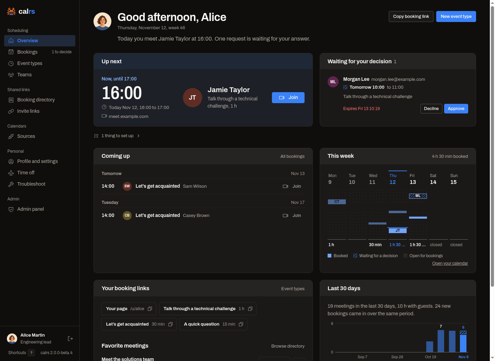
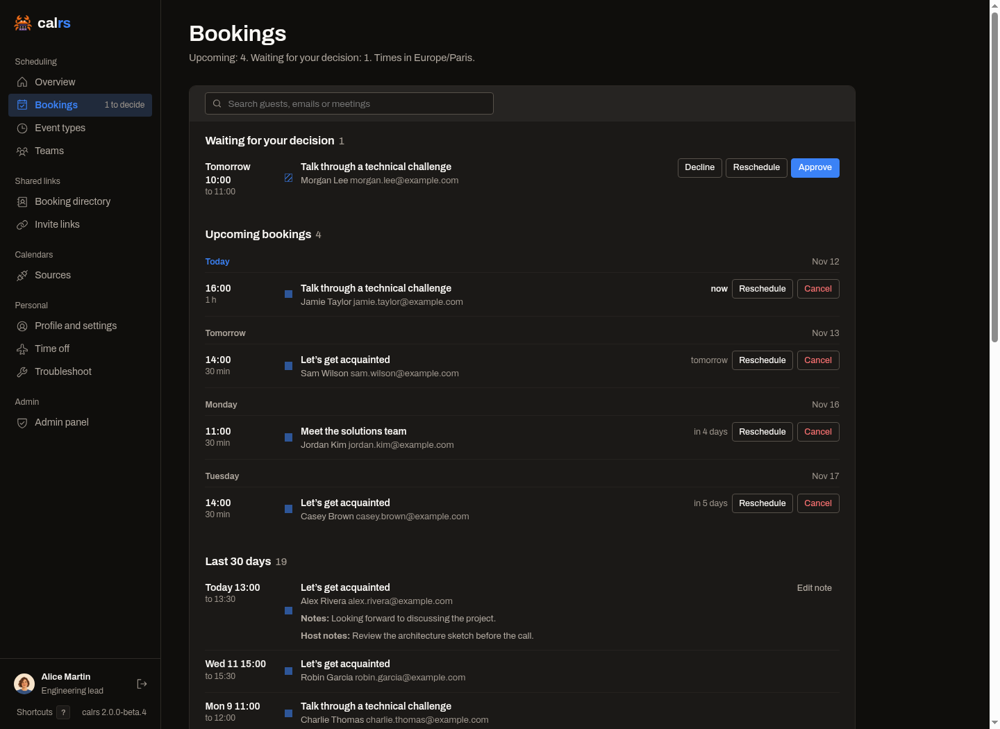
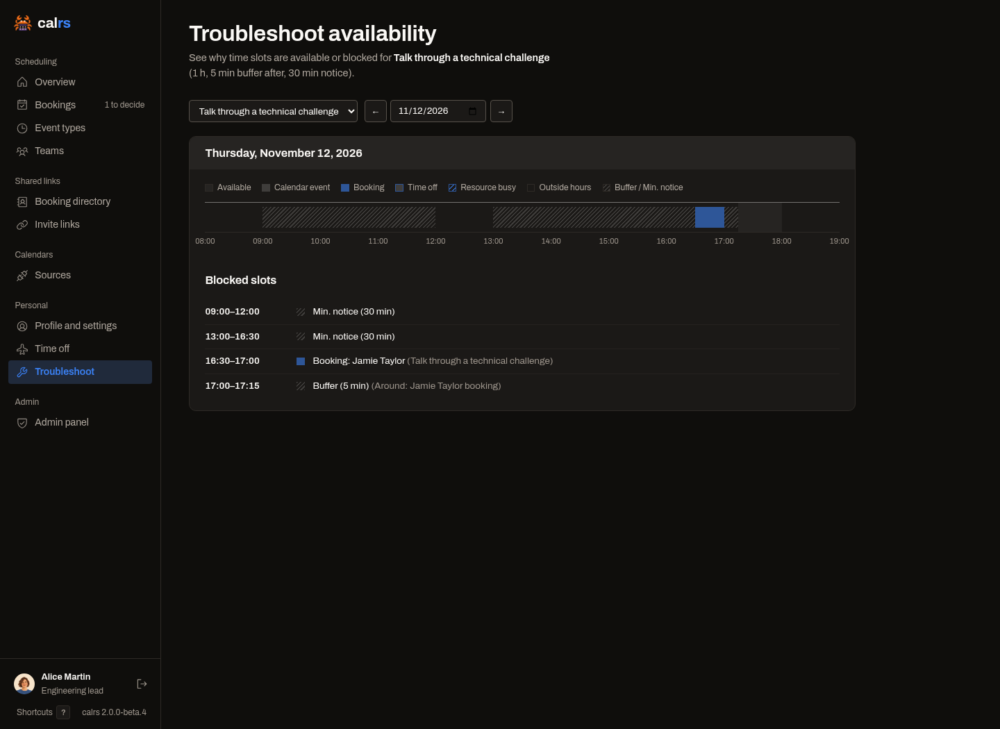

# Dashboard and Profile

Sign in and open `/dashboard` to manage your schedule. The sidebar links to event types, bookings, calendar sources, shared links, teams and settings. On a phone, open the sidebar from the menu button.

## Overview

The v2 overview brings together requests waiting for your decision, coming meetings and your week. The week view includes your calrs bookings and anonymous busy periods from connected calendars. Calendar event details remain in the availability troubleshooter. A dashed busy band means calrs could not expand a recurrence rule precisely; its tooltip links to the explanation.

Your booking links and favorite meetings sit beside recent activity and your event types. A new account sees setup guidance for connecting a calendar and creating a meeting.

## Bookings

Open **Bookings** for these sections:

- **Waiting for your decision**: pending requests to confirm or decline.
- **Available to claim**: bookings offered to teams you watch with.
- **Upcoming**: your coming meetings, including confirmed bookings you claimed.
- **Last 30 days**: recent past bookings.
- **Cancelled and declined**: bookings from 30 days ago onwards, including future cancellations.

Each section has its own pagination. Searching and pressing Enter searches across pages; typing also narrows the rows currently shown. A day selected in the overview's week opens the corresponding page of upcoming bookings.

Open a booking's title to read its details, question answers and [host-only notes](./booking-flow.md#host-notes). Actions offered depend on its status and your role. A **not in your calendar** badge means the booking exists but a calendar write failed; see [write-back recovery](./caldav.md#when-a-write-back-fails).

## Booking directory and favorites

The **Booking directory** helps colleagues find public and internal meetings they can share. Search by person, team or meeting title, and filter the list. Copy a public meeting's URL or generate a fresh, single-use invitation for an internal meeting.

Star meetings you use often to put them on your overview. Favorites do not grant permission: a meeting that becomes inaccessible disappears from your usable favorites. Private event types remain subject to their own invitation permissions.

Use **Invite Links** for internal meeting invitations and an event type's invite management page for guest-specific or bulk invitations. See [Event types](./event-types.md).

## Profile and settings

Use **Profile & Settings** to configure:

- Your name, username, avatar, title and Markdown bio.
- Where you are based and the languages you speak, shown on your public profile when set.
- Your timezone, language, public-page language policy and theme mode.
- Your booking email, used for booking communications when it differs from your account email.
- Default working hours and the first day of the week.
- Whether colleagues may include you in dynamic group links.
- [Two-factor authentication](./authentication.md#two-factor-authentication-totp), [API tokens](./api.md) and [connected apps](./mcp.md).

Public pages normally follow the visitor's browser language, even if the visitor is signed in. **Always my language** makes your own booking pages use your saved language instead. Host emails follow each host's saved language; guest emails retain the language used to book. The nine languages are English, French, Spanish, Polish, German, Italian, Estonian, Brazilian Portuguese and Dutch. **Deutsch (Sie)** is also available for formal German.

Default availability supplies the initial schedule for a new event type and constrains your participation in team and dynamic-group scheduling. Changing it does not rewrite the weekly rules of existing event types. Use [Time off](./event-types.md#time-off) to block an absence across meetings you host.

## Organize your public page

In the event type editor, give meetings a **Section** to group them on your profile. **Change the order** opens the ordering page. Team admins can arrange their team's page separately. See [Sections and order](./event-types.md#sections-and-order-on-your-page).

The usual-hours timetable on a public profile summarizes weekly rules; it is not a promise that every time in that span is available. Guests open a meeting to see actual slots after conflicts, exceptions and limits are applied.

## Availability troubleshoot

Open an event type's **Troubleshoot** action, select the date and inspect the timeline. It explains working hours, calendar conflicts, bookings, time off and other reasons a candidate slot is blocked. Check calendar selections, the event type's timezone, team members' hours and source sync errors when the result differs from what you expect.

