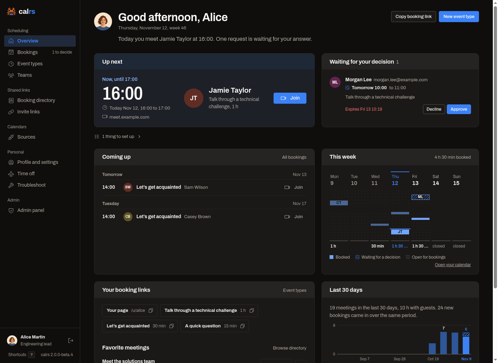

# calrs v2

**Self-hosted scheduling, built in Rust.**

Connect your calendars, define when people can book you, and share a link. calrs runs on your infrastructure with SQLite, a Rust executable and its HTML templates. It needs neither Node.js nor a separate database server.

This book describes the **v2 feature set**, including the current prereleases. It does not announce a stable v2 release. Check [Releases](https://github.com/olivierlambert/calrs/releases) for available versions; the container's `latest` tag follows stable releases and `next` follows prereleases. Existing installations should read [Upgrading to v2](./upgrading.md).

## Start here

- [Getting started](./getting-started.md): install, connect a calendar and make a first booking.
- [Features in v2](./features.md): the feature map, with links to setup and usage guides.
- [Dashboard and profile](./dashboard.md): your agenda, bookings, shareable links and personal settings.
- [Deployment](./deployment.md): containers, systemd, reverse proxies, configuration and backups.

## How it works

1. Connect CalDAV, Google Calendar, Microsoft 365 / Outlook, or on-premises Exchange.
2. Choose which calendars block your time and where confirmed bookings should be written.
3. Create a personal or team event type with working hours, timezone, duration and booking rules.
4. Share its booking link, generate an invitation, or embed it in your website.
5. Guests choose a time and complete your booking form. You can confirm automatically or approve each request.
6. calrs blocks the time, writes to the configured calendars and sends notifications through your configured email or SMS service.

Calendars and notifications are optional: calrs can schedule against its own bookings and provide an `.ics` download without SMTP. Connecting your calendars is how it also avoids conflicts with meetings made elsewhere.

## Built for individuals and teams

Personal meetings, round-robin teams, collective meetings and ad-hoc groups use the same booking flow. Public, internal and private visibility control how meetings are found and shared. Shared resources can reserve a room or lab alongside the people attending.

The interface and notifications support English, French, Spanish, Polish, German, Italian, Estonian, Brazilian Portuguese, Dutch and Russian, with a formal German option. Hosts set their own language and timezone; guests can view times in theirs.

Integrations include outgoing booking webhooks, a scoped REST API with an interactive OpenAPI reference, and an OAuth-protected MCP endpoint. See [Features in v2](./features.md) for the scope of each integration.
